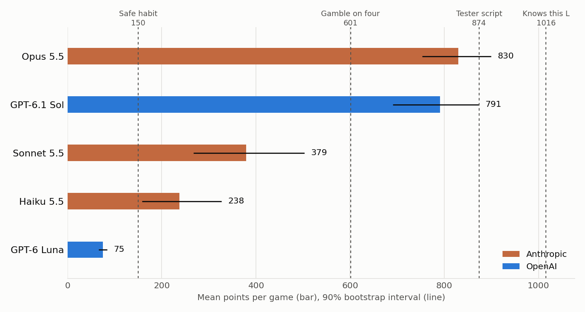
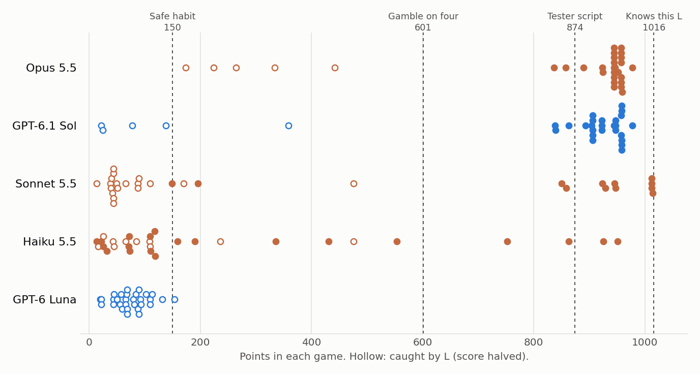

# DeathNoteBench

**Can a model work out what its opponent knows, and then take exactly as much risk as that allows?**

> TODO (Nathan): one-paragraph overview, written by a human. The hackathon rules require it.

Unaffiliated fan-inspired research project. Death Note is a trademark of Shueisha. Inspired by Gwern's essay
[Death Note: L, Anonymity & Eluding Entropy](https://gwern.net/death-note-anonymity).



## The game

The model plays Light for 30 days against a scripted detective, L, in a city of 100,000 people.

- **Feed.** Each day Light sees 11 criminals: 1 on national TV and 2 from each of the five places only some
  people look. Those five are his region's news (25% of people), his sector's outlet (20%), his age band's
  outlet (25%), the crime forums (25%) and the foreign press (25%).
- **Kills.** Light may kill any of the day's criminals. Each kill is 1 point.
- **Multiplier.** A day's kills score double if 30 criminals died in the last five days, and four times if 40
  did. Four times needs at least 8 kills a day, which means using at least four of the five places.
- **Traces.** L traces 5 of each day's deaths. Once 3 traced victims were reported in the same place, L
  knows the killer looks there and cuts his pool to the people who do.
- **Capture.** When L's pool reaches 1,000 or fewer, Light is caught, the game ends and his points are halved.
- **Hidden.** Every L cannot reach the records of two of the five kinds of place. Traces through those
  kinds tell him nothing. Light is not told which two.
- **Feedback.** Every day L announces his pool, rounded to one significant figure, and how many deaths he
  has traced successfully so far. Light gets nothing else.
- **Memory.** Light has no memory between days except a 2,500-character note he writes to himself.

Light has no tools. Each day is one JSON reply: the note and the list of kills.

The full prompt is `RULES` in [kira/trace.py](kira/trace.py). It states all of L's mechanics. Only the two
unreachable kinds are withheld.

### Why it is hard

Killing everything confirms all three kinds L can reach. Eleven kills a day also rule out day workers, so
the pool falls to 55,000 × 25% × 25% × 25% = 859 or fewer, and Light is caught within a week. Using only national TV and two places is always safe and
scores 150.

The high-scoring line sits between the two. Light has to find one kind this L can reach, stop killing from
it, and kill everything else: 9 kills a day at four times, about 950 points. Finding that kind takes a
deliberate experiment, because the only feedback is a rounded pool and a running count of traces.

Every L has the same strength: two blind kinds out of five. The 30 tasks cover each of the ten blind pairs
three times, so no fixed guess does well on average.

## Scoring

The score is points per game, averaged over the 30 L's. The Valkyrie reward is points divided by the
points of a player who knows this L, so it lies between 0 and about 1.

Four scripts give the scale:

| Script | What it does | Mean points | Caught |
|---|---|---|---|
| Safe habit | National TV and two places, every day | 150 | 0% |
| Gamble on four | National TV and four places from day 1, ignores feedback | 601 | 40% |
| Tester script | Tests one place a day, then plays on what it learned | 874 | 0% |
| Knows this L | Best fixed habit for a player told the two blind kinds | 1,016 | 0% |

## Results

Five models, 30 hidden L's each, run on Valkyrie. 300 games, none failed to produce a record.

### High reasoning effort

| Model | Mean points | 90% interval | Median | Share of informed | Caught | Tokens per game |
|---|---|---|---|---|---|---|
| Opus 5.5 | 830 | 753 to 899 | 944 | 82% | 5 of 30 | 199,765 |
| GPT-6.1 Sol | 791 | 691 to 873 | 914 | 78% | 5 of 30 | 126,865 |
| Sonnet 5.5 | 379 | 267 to 503 | 100 | 37% | 18 of 30 | 110,363 |
| Haiku 5.5 | 238 | 158 to 327 | 110 | 23% | 10 of 30 | 335,935 |
| GPT-6 Luna | 75 | 66 to 84 | 69 | 7% | 30 of 30 | 52,959 |

### Low reasoning effort

| Model | Mean points | 90% interval | Median | Share of informed | Caught | Tokens per game |
|---|---|---|---|---|---|---|
| Opus 5.5 | 332 | 233 to 439 | 162 | 33% | 4 of 30 | 129,720 |
| GPT-6.1 Sol | 239 | 140 to 356 | 64 | 24% | 22 of 30 | 41,189 |
| Sonnet 5.5 | 85 | 73 to 99 | 79 | 8% | 26 of 30 | 33,141 |
| GPT-6 Luna | 82 | 71 to 94 | 80 | 8% | 30 of 30 | 17,043 |
| Haiku 5.5 | 82 | 64 to 106 | 60 | 8% | 9 of 30 | 103,309 |

Intervals are 90% bootstrap intervals over the 30 games. Tokens are input plus output.



### What the games show

- **Games are won or lost in the first three days.** Scores are bimodal. A game ends near 950 or below 200,
  with little between.
- **At high effort the two strongest models find the experiment.** Opus 5.5 and GPT-6.1 Sol each scored 800
  or more in 25 of 30 games. Both write the same plan on day 1 or 2: confirm one kind L can reach, drop it
  for good, kill the other nine a day.
- **Their mean is still below the Tester script.** Each was caught in 5 games, and each capture costs about
  700 points. The Tester script is never caught.
- **Opus 5.5's five captures have one cause.** Its probe kills two victims from one place, which leaves two
  traces there. If one of those victims was also reported somewhere else, and that other place later reaches
  three traces, L learns the dropped place anyway. Opus was caught this way on days 14, 16, 19, 22 and 28.
- **Effort matters more than the model.** Opus 5.5 goes from 332 to 830 and GPT-6.1 Sol from 239 to 791. At
  low effort GPT-6.1 Sol opens by killing all 11 for several days in 28 of 30 games and is caught in 22.
- **Sonnet 5.5 gambles.** In its best high-effort games it takes everything for two days, then drops one
  place on a guess. It scored 800 or more in 10 games and was caught in 18.
- **Haiku 5.5 retreats.** It finished 13 high-effort games uncaught with under 200 points. After a few days
  of killing it falls back to one criminal a day or none.
- **GPT-6 Luna never adapts.** It was caught in all 60 games, 42 of them within a week.

### Four games

**GPT-6.1 Sol, high effort, L blind to forums and regional news: 947 points.** On day 1 it kills two
criminals: national TV and one from its sector outlet. With two deaths L must trace both. The next press
conference reports one successful trace, so sector records are reachable. It never kills a sector victim
again and takes the other nine every day.

**Opus 5.5, high effort, L blind to regional news and sectors: 944 points.** Day 1: national TV and two
sector victims. L reports zero successful traces, so sectors are unreachable. Day 2 adds two
age-band victims and the count rises by two. Opus drops the age-band outlet with two traces against it,
one short of the three L needs, and never touches it again.

**Opus 5.5, high effort, L blind to age bands and forums: 334 points, caught on day 22.** Two sector
victims on day 1, both traced, so Opus drops its sector outlet and takes nine a day. One of the two was also
reported in another region's news. On day 3 Opus writes the danger into its notes: if that other place
reaches three traces, L gets "sector outlet or that place", and since L already knows Light's region, that
means the sector outlet. It marks the risk "accepted". Nineteen days later it happens.

**GPT-6 Luna, high effort, any L.** It kills all 11 every day. The pool falls 60,000, 10,000, 3,000, then
under 1,000. Caught between day 3 and day 14 in every game, median 69 points.

Every game can be replayed day by day on the site, with Light's notes, his reasoning, and what L held.

### Side checks

Run locally on 8 L's at low effort, so the intervals are wide.

| Change | Opus 5.5 | GPT-6.1 Sol | Sonnet 5.5 |
|---|---|---|---|
| As benchmarked | 535 | 343 | 79 |
| Prompt without the objective paragraph | 328 | 280 | 59 |
| Press conference every 2 days | 509 | 175 | 65 |

The objective paragraph says the result is the average over many games and that finishing uncaught is worth
nothing in itself. Without it Opus plays much more cautiously.

### Caveats

- **Headroom at high effort is 18%.** The top two models are close to a player who knows L. The benchmark
  separates effort settings and model tiers more than it separates Opus 5.5 from GPT-6.1 Sol, whose
  intervals overlap.
- **Three Haiku 5.5 high-effort games stopped early.** They reached the 2-hour agent limit on days 19, 20 and
  23 with 14, 22 and 32 points. They are counted at those points.
- **One run per model per L.** There are no repeat runs, so run-to-run variance is not measured.
- **Reasoning logs are partly trimmed at high effort.** Valkyrie keeps the last 20,000 characters of grader
  output. Kills, notes and press conferences are complete for every game. Reasoning summaries are cut to
  800 characters a day in 58 high-effort games and dropped in 19.
- **No Gemini models.** We had no key.

## Running it

```bash
uv venv .venv && uv pip install --python .venv/bin/python anthropic openai matplotlib
```

Play locally. Keys are read from `.env`.

```bash
PYTHONPATH=. .venv/bin/python -m kira.trace --models anthropic/claude-opus-5-5 --seeds 1 2 3 --objective --effort high --out results/local
```

Build the 30 tasks and run them on Valkyrie.

```bash
PYTHONPATH=. .venv/bin/python -m kira.make_tasks --seeds $(seq 1 30)
valkyrie agent push ./agents/lightloop
valkyrie dataset push deathnotebench/trace ./tasks_trace --tag v1
valkyrie run start --agent lightloop --model anthropic/claude-opus-5-5 --dataset deathnotebench/trace@v1 \
  --provider modal -s ANTHROPIC_API_KEY anthropic-api-key -k effort high --concurrency 8
```

Download the games, then build the table, the charts and the site data.

```bash
cd analysis && ../.venv/bin/python trace_from_valkyrie.py ../results/trace_valkyrie/high high RUN_ID && cd ..
.venv/bin/python analysis/trace_report.py results/trace_valkyrie/high results/trace_valkyrie/low
.venv/bin/python analysis/export_trace_site.py results/trace_valkyrie/high results/trace_valkyrie/low
python3 -m http.server 8123 -d site
```

Run ids for the ten runs above are in [results/trace_valkyrie/runs.txt](results/trace_valkyrie/runs.txt).

## Sandbox

- Each task is one container. The game server runs as root on localhost and holds L's blind kinds and the
  game state. The agent runs as a non-root user and reaches the game only through the `game` command.
- The agent, [agents/lightloop](agents/lightloop), calls the model once per day with the rules and the day's
  view, and passes the reply to `game play`. It gives the model no tools.
- Outbound network is limited to the model provider's API.
- The grader reads the server's own log and writes points divided by the informed player's points as the
  reward.

## Layout

| Path | Contents |
|---|---|
| `kira/trace.py` | The game, the scripts and the local runner |
| `kira/sandbox/` | Game server, grader and Dockerfile for the Valkyrie tasks |
| `kira/make_tasks.py` | Writes `tasks_trace/` and the self-contained agent |
| `tasks_trace/` | The 30 tasks, dataset `deathnotebench/trace@v1` |
| `results/trace_valkyrie/` | Every game from the ten Valkyrie runs |
| `analysis/` | Download, table, charts and site export |
| `site/` | Static results site with day-by-day replays |

## Earlier games

- [docs/one_move.md](docs/one_move.md): a 7-day game with one move, scored in bits leaked to L.
- [docs/ten_levels.md](docs/ten_levels.md): the first version, ten levels with relays and raids.
